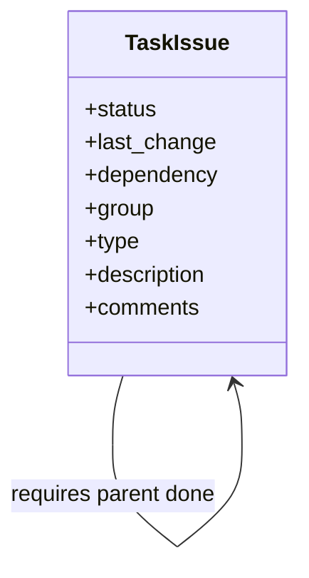

# Struktura projektu a evidence úloh

Tato pravidla popisují aktuální lokální projekt a další práci. Stav ověřen 2026-10-10. Nálezy a rozsah revize jsou v [revizi](review-2026-10-10.md); základní popis aplikace v [translate.md](translate.md).

## Struktura projektu

```text
doctranslate/                      kořen aktivního repozitáře
├── translate.cmd                 uživatelský launcher: python -m doctranslate
├── pyproject.toml                balíček, závislosti a console entrypoint
├── .gitignore                    pravidla ignorování runtime souborů
├── AGENTS.md                     projektové instrukce
├── agent_metrics.yaml            měření schopností lokálního agenta
- translate.config.json je lokální konfigurace, nikoli zdroj. Standardně patří do aktuálního pracovního adresáře; cestu lze nastavit přes TRANSLATE_CONFIG_FILE.
├── translate_job.json            stávající legacy odkaz na poslední job
├── src/
│   └── doctranslate/             jediný aktivní zdrojový balíček
│       ├── __main__.py           modulový vstup
│       ├── config.py             konfigurace a locale
│       ├── observability.py      sdílený best-effort JSONL event logger
│       ├── queue_app.py          CLI/GUI, JSON store a ovládání workeru
│       ├── queue_worker.py       samostatný worker a plánování jobů
│       ├── translate.py          stávající překlad/HTML/PDF orchestrace
│       └── translate_core/
│           ├── contracts.py      XHTML dokument, bloky a metadata
│           ├── adapters.py       protokoly backendů a registr formátů
│           ├── pipeline.py       formátově nezávislý překladový kontrakt
│           └── pdf_adapter.py    hranice PDF pluginu
├── test/
│   ├── test_*.py                 unit a malé integrační testy
│   ├── test_observability.py     regresní testy strukturovaného logování
│   ├── regression/               procedury dokumentové regrese
│   └── mock/                     trvalé testovací PDF/HTML a referenční archiv
├── doc/                          projektová dokumentace
│   ├── translate.md              funkce, architektura a aktuální stav
│   ├── tools.md                  kuchařka nástrojů a workaroundů
│   ├── review-2026-10-10.md       revize a index konkrétních issues
│   ├── modularization-analysis.md  cílové formátové/AI moduly, UML a implementační backlog
│   └── project-structure-and-tasks.md
├── tasks/                        aktivní plaintext issues
│   └── done/                     uzavřené issues se zachovanou evidencí
├── tasks-local-ai/               izolovaný balíček budoucí delegace
│   ├── context/                  rozdělený kontext a kopie nástrojové kuchařky
│   └── tasks/                    malé tasky s pořadím a dependency
├── local-ai-test/                pouze offline kalibrační scénáře
├── tmp/                          pracovní vstupy/výstupy, scratch a logy
└── tmp_local_agent_*             lokální komunikační artefakty agenta
```

- Zdrojový Python patří do `src/doctranslate`, testy do `test`. V kořeni nevytvářet kopie modulů ani kompatibilní wrappery.
- `test/mock` jsou trvalé testovací podklady; nepatří do `tmp`. `tmp` není jediným místem běžných výstupů: uživatel vybírá `workdir` a cesty jobu.
- `workdir` obsahuje `queue.json`, `queue.lock`, `queue.bak`, `worker.lock`, `worker-state.json`. Checkpoint/cache/log/HTML/PDF leží u explicitního výstupu jobu.
- `translate.config.json` je lokální konfigurace, nikoli zdroj. Umístění v nainstalovaném režimu řeší existující validační issue.
- Kořenový `translate_job.json` je stávající legacy soubor, ne nový požadavek pro root. Jeho budoucí umístění musí respektovat workdir; tato dokumentační změna jej nepřesouvá.
- Povinný protokol lokálního agenta používá kořenové `tmp_local_agent_in.md`, `tmp_local_agent_out.log`, `tmp_local_agent_checkpoint.json`. Jsou ignorované Gitem, nemazat je automaticky.
- `.git`, `.pytest_cache` a `__pycache__` jsou správa repozitáře/generované cache. V kořeni navíc existuje ignorovaný adresář `doctranslate/` s vlastním Git repozitářem: jde o oddělenou lokální kopii, nikoli zdroje tohoto balíčku. Nerevidovat, neměnit ani nemazat jej automaticky.
- Další dokumenty v `doc`, například testingRules, localAgent a cleanup-candidates, zůstávají zachované. Strom ukazuje podstatné položky, ne kompletní inventuru.

## Formát task souboru

Umístění aktivního issue: `tasks/<priorita>-<datum-vzniku>-<strucny-popis>.md`. Po uzavření se stejný soubor přesune do `tasks/done/`; název a obsah se nemění kromě finálního statusu a komentáře.

Příklad názvu: `2-2026-10-10-worker-se-nespusti-pres-balicek.md`. Priorita 1 je critical, 2 high, 3 normal, 4 improvement, 5 low. Datum v názvu je neměnné datum vzniku, formát YYYY-MM-DD; slug používat stručný, ASCII a s pomlčkami. Jeden soubor popisuje jednu přezkoumatelnou změnu.

```text
status: created
last change: 2026-10-10
dependency: done/1-2026-10-10-kontrola-pid-ukoncuje-worker-na-windows.md
group: runtime/worker/startup
type: bug
description:
Problém, dopad a očekávané chování.
Evidence: zdroj nebo reprodukce; odlišit ověřenou chybu od rizika.
Recommended change: přiměřené řešení a rozsah.
Acceptance: jak poznáme dokončení a jak jej ověříme.

comments:
2026-10-10: Založeno; důvod priority a případné blokátory.
```

| Pole | Požadavek |
|---|---|
| status | Povinný první řádek; created, progress, test nebo done. |
| last change | Datum poslední skutečné změny tasku, YYYY-MM-DD. Nejde jen o datum změny stavu. |
| dependency | Povinný řádek pro jednotný formát; `none` bez rodičů. Jinak relativní cesty k parent issues z `tasks/` nebo `tasks/done/`, oddělené čárkou a mezerou. Všichni rodiče musí být splnění. |
| group | Oblast v hierarchii oddělené `/`, malá ASCII písmena, číslice a pomlčky; např. `persistence/queue`. Hloubku zvyšovat jen pro užitečné členění. |
| type | bug, feature, refactor, test, documentation nebo tooling. Typ určuje druh práce, ne prioritu. Nový typ přidat jen když existující nestačí. |
| description | Problém/záměr, dopad, doporučení a podmínky dokončení. Evidence má rozlišit reprodukci, statickou revizi a hypotézu. |
| comments | Datované změny, rozhodnutí, průběh implementace a výsledky ověření. Nový záznam doplnit, předchozí nesmazat. |

`dependency` znamená skutečný implementační předpoklad, nikoli jen související téma nebo nadřazenou kategorii. Více rodičů tvoří acyklický graf. Opačný odkaz v rodiči není povinný; děti lze najít podle jejich dependency. Zákaz self-reference, neexistujících souborů a cyklů. Při oboustranné závislosti společný invariant vyjmout do předchozího tasku nebo úlohy sloučit; nevytvářet kruhovou frontu.

Při změně priority přejmenovat soubor a opravit dependency i dokumentační odkazy. Slug se jinak nemění bez důvodu. Po přechodu do `done` se issue přesune do `tasks/done/` jako evidence rozhodnutí. Před přesunem doplnit poslední komentář s datem, výsledkem validace a případnými omezeními. Do `tasks/` patří jen otevřená issues ve stavech `created`, `progress` nebo `test`.

## Skupiny stávajícího backlogu

| Kořen skupiny | Obsah |
|---|---|
| runtime | procesní API, start a ovládání workeru |
| persistence | zámky, JSON fronta a ukládání/kapacita disku |
| app | start aplikace, validace a CLI vstupy |
| translation | Ollama a XHTML obsahový kontrakt |
| quality | testy a integrační ověření |
| architecture | postupný refaktoring orchestrace |
| tooling | lokální implementační agent a vývojové nástroje |

Skupina nemění pořadí fronty překladových jobů. Priorita, dependency a type se týkají vývojových issues; joby stále plánuje worker podle in_progress a prepared, poté podle pořadí v seznamu.

## Stavy a pořadí zpracování

1. Před prací načíst AGENTS.md a tools.md, ověřit Git a relevantní tasky v `tasks/` i `tasks/done/`. Respektovat oprávnění, kalibraci a supervisor policy.
2. Z rozpracovaných tasků nejdříve pokračovat v test/ověření a progress, pokud není nutné přednostně řešit novou kritickou chybu. Částečnou práci nepřepisovat.
3. Task je připravený pro navazující implementaci, pokud není done a všechny dependency jsou done. Analýzu nebo návrh lze připravit dříve; blokaci uvést do comments, nepřidávat stav blocked.
4. Mezi připravenými tasky vybírat nejnižší číselnou prioritu. Při shodě preferovat odblokování dalších oprav a související rozpracovanou oblast; potom starší datum vzniku a název souboru.
5. Pokud důležitý task čeká na rodiče s nižší prioritou, zpracovat nezbytné předpoklady před ním; prioritu rodiče nepřepisovat jen kvůli pořadí. Změny skutečné naléhavosti samostatně zdůvodnit.
6. Přechody: created → progress → test → done. Test failure → progress; znovuotevření done zdůvodnit v comments. Done až po kontrole diffu a splnění Acceptance, nikoli po napsání dokumentace. Po označení done soubor přesunout do `tasks/done/` a aktualizovat odkazy/závislosti.
7. Regresní test patří do opravy rodičovského bug tasku. Souhrnný task `quality/tests/integration` ověřuje celek až po opravách; jeho dependency neznamenají čekání se všemi testy až na konec.
8. Tasky mohou být nezávislé, ale Codex a lokální agent nesmějí současně editovat stejný repozitář. Bez souhlasu nevytvářet commit/push. PDF sazbu nadále spouští uživatel.

Pro tento projekt je používání lokálního Qwen/Continue agenta do odvolání vypnuté projektovým AGENTS.md. Implementační tasky proto nejsou závislé na opravě lokálního tooling; přímá implementace a offline testování jsou povolené podle aktuálního zadání. Izolované instrukce v tasks-local-ai zůstávají samostatné.

## Doporučené pořadí aktuálního backlogu

Následující pořadí respektuje uvedené dependency. Je to plán pro aktuální stav, nikoli další uložená číselná priorita. Při změně backlogu nebo stavu plán přehodnotit.

| Krok | Priorita | Issue | Group | Type |
|---|---|---|---|---|
| prostředí | 3 | [Lokální implementační agent se nedostane k úloze](../tasks/3-2026-10-10-lokalni-agent-blokovan-continue-serverem.md) | tooling/local-agent | tooling |
| 1 | 1 | [Kontrola PID ukončuje proces na Windows](../tasks/done/1-2026-10-10-kontrola-pid-ukoncuje-worker-na-windows.md) | runtime/process | bug |
| 2 | 2 | [Worker nelze spustit současným launcherem](../tasks/done/2-2026-10-10-worker-se-nespusti-pres-balicek.md) | runtime/worker/startup | bug |
| 3 | 2 | [Zámek není bezpečný při inicializaci a selhání zápisu](../tasks/done/2-2026-10-10-lock-recovery-a-selhani-zapisu.md) | persistence/locks | bug |
| 4 | 2 | [Starší kopie fronty přepisuje nové stavy jobů](../tasks/done/2-2026-10-10-update-fronty-prepisuje-novejsi-stavy.md) | persistence/queue | bug |
| 5 | 2 | [Životní cyklus workeru nesouhlasí s dlouhými dávkami a editacemi](../tasks/done/2-2026-10-10-heartbeat-stop-pause-a-zmeny-aktivniho-jobu.md) | runtime/worker/control | bug |
| 6 | 2 | [Chybí včasná kontrola prostoru a řízené chyby ukládání](../tasks/done/2-2026-10-10-nedostatek-mista-a-chyby-ulozeni.md) | persistence/storage | bug |
| 7 | 3 | [Bootstrap a balíčkový entrypoint nemají jednotné chyby](../tasks/done/3-2026-10-10-bootstrap-zavislosti-a-jednotne-chyby-cli.md) | app/startup | bug |
| 8 | 3 | [Nenalezené HTML vypíše traceback; příkaz má jinou pomlčku](../tasks/done/3-2026-10-10-nenalezene-html-rozdil-pomlcky-v-ceste.md) | app/cli/input | bug |
| 9 | 3 | [Fronta a konfigurace přijímají některá neplatná data bez vysvětlení](../tasks/done/3-2026-10-10-validace-fronty-konfigurace-a-vstupu.md) | app/validation | bug |
| 10 | 3 | [GUI nerozlišuje nedostupnou Ollamu od prázdné nabídky modelů](../tasks/done/3-2026-10-10-ollama-modely-a-stav-nabidky-v-gui.md) | translation/ollama | bug |
| 11 | 3 | [Překladové core nechává markup v původním jazyce](../tasks/done/3-2026-10-10-xhtml-text-a-markup-se-rozchazeji.md) | translation/xhtml | bug |
| 12 | 3 | [Zelené testy nepokrývají skutečný start a provozní selhání](../tasks/done/3-2026-10-10-testy-nepokryvaji-zivotni-cyklus-workeru.md) | quality/tests/integration | test |
| 13 | 4 | [Postupně oddělit job context, backend a PDF adapter](../tasks/done/4-2026-10-10-zjednoduseni-orchestrace-a-globalniho-stavu.md) | architecture/orchestration | refactor |
| 14 | 5 | [Připravit instrukce a kalibraci lokálního agenta](../tasks/done/5-2026-10-10-local-agent-reimplementation-test.md) | tooling/local-agent/instructions | tooling |

Nízká priorita refaktoringu není důvod přeskočit kritické opravy. Po jejich stabilizaci lze menší mechanické zpřehlednění přidat přímo do příslušného tasku, pokud nerozšiřuje jeho rozsah.

## Nový backlog modularizace

Implementační analýza M01–M14 je v [implementační analýze](modularization-analysis.md#a12-tasky-poradi-a-dokonceni). V tomto průchodu byly tasky M01–M14 dokončeny, ověřeny a přesunuty do \`tasks/done/\`; každý zachovává dependency, ověřovací podmínky a historii v \`comments\`. Otevřené zůstávají pouze M15 a evidenční task lokálního agenta, které tento průchod záměrně neřeší. Výše uvedená tabulka je evidence předchozí revize.

## Povinná UML dokumentace high-level architektury

Společné pravidlo patří do globálního uživatelského ~/.codex/AGENTS.md, sekce Software architecture documentation, pro softwarové projekty. Zápis v této relaci selhal i po udělení oprávnění. Do aplikace globálního patche pravidlo závazně obsahuje [projektový AGENTS.md](../AGENTS.md); překážka je v [M15](../tasks/4-2026-10-10-globalni-uml-pravidlo-zapis.md).

- Strukturu aplikace, veřejné kontrakty, komponenty a závislosti popisovat Mermaid UML classDiagram.
- Všechny high-level aplikační procesy popisovat Mermaid UML sequenceDiagram; zahrnout důležité alternativy, chyby, přerušení a obnovu.
- Vést index procesů s odkazy na diagramy; jeden diagram může pokrýt související scénáře pomocí alt/opt/loop.
- Oddělovat aktuální implementaci od cílového návrhu. Diagramy aktualizovat při změně odpovědností, kontraktů nebo toků.
- Dokumentovat nejvyšší užitečnou úroveň; nevytvářet diagram každé privátní metody ani redundantní kopie v každém tasku.
- Pro modularizaci je index a sequence diagramy v [A13](modularization-analysis.md#a13-uml-procesy), class diagram v [A03](modularization-analysis.md#a03-cilove-vrstvy). Tasky referencují konkrétní části.


