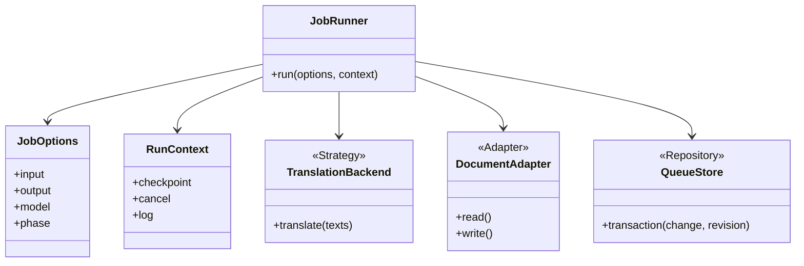
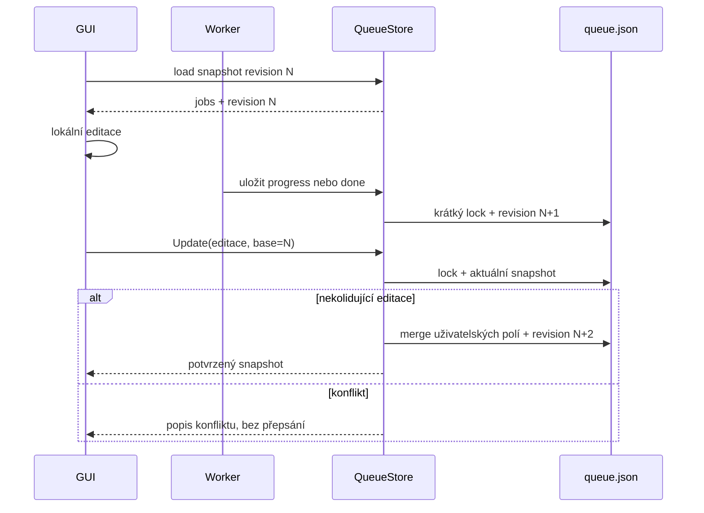

# Revize projektu – 2026-10-10

Revize k lokálnímu HEAD `70d9fd9` (AI doc translation) a následné lokální opravě. Zkoumány zdroje, startovací skript, konfigurace, dokumentace a testy. Sazba PDF ani překlad knihy nebyly spuštěny. Ollama nebyla kvůli aplikaci spouštěna, modely nebyly instalovány; calibration lokálního implementačního agenta se ke tool callům nedostala.

## Výsledek a meze revize

- Po následné implementaci observability prochází offline suite 51 testů. Tento výsledek potvrzuje offline regresní scénáře, nikoli živou Ollamu ani vizuální shodu PDF.
- Modulový start workeru, import `translate` uvnitř run_job a fake-backend lifecycle nyní procházejí; živá Ollama ani sazba PDF ověřeny nebyly.
- Fault injection/reprodukce potvrzuje lost update fronty, neuklizený lock po ENOSPC, stale vyhodnocení čerstvého prázdného locku, falešné stopped při starém heartbeatu, odeslání dirty změn tlačítkem Start, příliš volné job schema, tiché nahrazení vadného configu výchozím a nesoulad core text/markup.
- Mock nedostupné Ollamy a prázdného seznamu modelů potvrdil použitelné chybové zprávy překladové cesty.
- Mock ENOSPC při zápisu fronty zachoval původní queue.json. Atomické replace je dobrý základ, ale neřeší konflikt zastaralých snapshotů ani všechny chyby ukládání.
- Chybějící pymupdf bylo simulováno import hookem: blokuje i queue status. Python/Ollama nebyly z počítače odinstalovány; disk nebyl skutečně zaplňován.
- Windows PID problém byl ověřen staticky a nyní je nahrazen bezpečnou kontrolou stavu procesu; živý child-process smoke test prošel. Primární zdroj původní chyby je [dokumentace Pythonu](https://docs.python.org/3/library/os.html#os.kill).
- R = izolovaná reprodukce/mock; S = statická revize. S znamená navržený nebo rizikový scénář, ne úspěšný integrační test.

## Priority a evidence issues

1 = critical: bezprostřední destruktivní chování nebo ztráta dat.
2 = high: blokuje hlavní workflow nebo ohrožuje konzistenci a obnovu.
3 = normal: potřebná odolnost/diagnostika/testy, existuje omezení či workaround.
4 = improvement: snižuje složitost a budoucí náklady; neblokuje opravy.
5 = low: kosmetické nebo zatím nepotřebné. Z revize žádný takový issue nevznikl.

Odhad priority je předběžný podle dopadu a reprodukce, ne podle počtu řádků. 15 issues: P1=1, P2=5, P3=7, P4=1, P5=1. Čtrnáct issues je po ověření přesunuto do `tasks/done/`; jeden zůstává v aktivním backlogu. Duplicitní scénáře odkazují na stejný issue.

| Priorita | Issue | Stav |
|---|---|---|
| 1 | [Kontrola PID ukončuje proces na Windows](../tasks/done/1-2026-10-10-kontrola-pid-ukoncuje-worker-na-windows.md) | done |
| 2 | [Worker nelze spustit současným launcherem](../tasks/done/2-2026-10-10-worker-se-nespusti-pres-balicek.md) | done |
| 2 | [Starší kopie fronty přepisuje nové stavy jobů](../tasks/done/2-2026-10-10-update-fronty-prepisuje-novejsi-stavy.md) | done |
| 2 | [Zámek není bezpečný při inicializaci a selhání zápisu](../tasks/done/2-2026-10-10-lock-recovery-a-selhani-zapisu.md) | done |
| 2 | [Chybí včasná kontrola prostoru a řízené chyby ukládání](../tasks/done/2-2026-10-10-nedostatek-mista-a-chyby-ulozeni.md) | done |
| 2 | [Životní cyklus workeru nesouhlasí s dlouhými dávkami a editacemi](../tasks/done/2-2026-10-10-heartbeat-stop-pause-a-zmeny-aktivniho-jobu.md) | done |
| 3 | [Bootstrap a balíčkový entrypoint nemají jednotné chyby](../tasks/done/3-2026-10-10-bootstrap-zavislosti-a-jednotne-chyby-cli.md) | done |
| 3 | [Fronta a konfigurace přijímají některá neplatná data bez vysvětlení](../tasks/done/3-2026-10-10-validace-fronty-konfigurace-a-vstupu.md) | done |
| 3 | [GUI nerozlišuje nedostupnou Ollamu od prázdné nabídky modelů](../tasks/done/3-2026-10-10-ollama-modely-a-stav-nabidky-v-gui.md) | done |
| 3 | [Překladové core nechává markup v původním jazyce](../tasks/done/3-2026-10-10-xhtml-text-a-markup-se-rozchazeji.md) | done |
| 4 | [Postupně oddělit job context, backend a PDF adapter](../tasks/done/4-2026-10-10-zjednoduseni-orchestrace-a-globalniho-stavu.md) | done |
| 3 | [Zelené testy nepokrývají skutečný start a provozní selhání](../tasks/done/3-2026-10-10-testy-nepokryvaji-zivotni-cyklus-workeru.md) | done |
| 3 | [Nenalezené HTML vypíše traceback; příkaz má jinou pomlčku](../tasks/done/3-2026-10-10-nenalezene-html-rozdil-pomlcky-v-ceste.md) | done |
| 5 | [Izolované instrukce lokálního agenta](../tasks/5-2026-10-10-lokalni-agent-blokovan-continue-serverem.md) | created |
| 5 | [Připravit instrukce a kalibraci lokálního agenta](../tasks/done/5-2026-10-10-local-agent-reimplementation-test.md) | done |

## Okrajové podmínky

| ID | Podmínka | Aktuální pokrytí | Co kód dělá | Doporučená změna | Issue | Evidence |
|---|---|---|---|---|---|---|
| E01 | Chybí python nebo fungující PATH | Opraveno s omezením | translate.cmd hledá python/py a vrací stručnou instalační chybu. | Zachovat platformní diagnostiku. | [P3](../tasks/done/3-2026-10-10-bootstrap-zavislosti-a-jednotne-chyby-cli.md) | S |
| E02 | Python je starší než 3.11 / jiný interpreter | Opraveno | Runner má version gate 3.11. | Zachovat shodu s pyproject. | [P3](../tasks/done/3-2026-10-10-bootstrap-zavislosti-a-jednotne-chyby-cli.md) | S |
| E03 | Chybí pymupdf | Opraveno | Queue status neimportuje PDF engine; PDF režim vrací instalační pokyn. | Zachovat lazy import. | [P3](../tasks/done/3-2026-10-10-bootstrap-zavislosti-a-jednotne-chyby-cli.md) | R |
| E04 | PyMuPDF je příliš staré | Opraveno | PDF runtime kontroluje minimální verzi a bootstrap vrací nenulový exit. | Ponechat kontrolu. | [P3](../tasks/done/3-2026-10-10-bootstrap-zavislosti-a-jednotne-chyby-cli.md) | S |
| E05 | Chybí Tk / desktop session | Opraveno s omezením | GUI start má pojmenovanou chybu; CLI zůstává dostupné. | Zachovat CLI fallback. | [P3](../tasks/done/3-2026-10-10-bootstrap-zavislosti-a-jednotne-chyby-cli.md) | S |
| E06 | Chybí Ollama i executable | Opraveno v GUI discovery | GUI stav offline je rozlišitelný; instalace zůstává ruční. | Zachovat bez automatické instalace. | [P3](../tasks/done/3-2026-10-10-ollama-modely-a-stav-nabidky-v-gui.md) | R |
| E07 | Ollama je instalovaná, ale neběží | Opraveno v GUI discovery | Offline stav se načítá mimo Tk vlákno a nepřepisuje model. | Živé ověření zůstává manuální. | [P3](../tasks/done/3-2026-10-10-ollama-modely-a-stav-nabidky-v-gui.md) | S |
| E08 | Vzdálený endpoint, DNS/TLS/HTTP chyba | Částečně | Discovery zachová offline detail; vzdálené TLS/produkční endpointy nejsou integračně ověřené. | Rozšířit validaci URL jen pokud bude vzdálený backend podporovaný. | [P3](../tasks/done/3-2026-10-10-ollama-modely-a-stav-nabidky-v-gui.md) | S |
| E09 | Ollama běží, nemá žádné modely | Opraveno | GUI stav empty odlišuje běžící Ollamu bez modelů od offline stavu a ponechá výchozí/uložený model. | Zachovat ruční instalaci modelů. | [P3](../tasks/done/3-2026-10-10-ollama-modely-a-stav-nabidky-v-gui.md) | R |
| E10 | Vybraný model není nainstalovaný | Opraveno s omezením | Uložený model se nepřepíše a GUI zobrazí discovery stav; instalace zůstává ruční. | Při překladu ponechat čitelnou chybu ensure_available. | [P3](../tasks/done/3-2026-10-10-ollama-modely-a-stav-nabidky-v-gui.md) | R |
| E11 | Vadná /api/tags odpověď nebo pomalé discovery | Opraveno | Discovery rozlišuje invalid/offline a běží mimo Tk vlákno. | Zachovat timeout a bezpečný návrat při zavření GUI. | [P3](../tasks/done/3-2026-10-10-ollama-modely-a-stav-nabidky-v-gui.md) | S |
| E12 | Nedostatek RAM/VRAM, příliš velký kontext | Částečné | Context tuning/reduction a rozdělení batch existují; živé resource limity nejsou testované. | Doplnit až s dostupnou Ollamou/modelovým benchmarkem. | [P3](../tasks/done/3-2026-10-10-testy-nepokryvaji-zivotni-cyklus-workeru.md) | S |
| E13 | Timeout, výpadek při překladu, invalid JSON | Částečné | Retry, splitting, validace a zachování platných bloků existují; živý backend není v suite. | Ověřit s ručním modelovým testem. | [P3](../tasks/done/3-2026-10-10-testy-nepokryvaji-zivotni-cyklus-workeru.md) | S |
| E14 | Disk plný na výstupu | Opraveno pro JSON/runtime artefakty | Atomický JSON zápis kontroluje volné místo a při chybě zachová předchozí cíl; PDF output mimo rozsah. | Rozšířit preflight na PDF/temp svazky, pokud bude sazba automatizovaná. | [P2](../tasks/done/2-2026-10-10-nedostatek-mista-a-chyby-ulozeni.md) | R |
| E15 | Disk plný v systémovém TEMP / log volume | Částečné | Worker-state má fallback na stderr; všechny externí temp/log svazky nejsou kontrolovány. | Kontrolovat používané svazky při automatizované PDF fázi. | [P2](../tasks/done/2-2026-10-10-nedostatek-mista-a-chyby-ulozeni.md) | S |
| E16 | Read-only workdir, EACCES, sdílený nebo otevřený výstup | Opraveno pro JSON/runtime artefakty | OSError je pojmenována jako StorageError, předchozí JSON zůstává; worker vypíše fallback diagnostiku. | Doplnit jednotnou GUI reakci a PDF write probe. | [P2](../tasks/done/2-2026-10-10-nedostatek-mista-a-chyby-ulozeni.md) | S |
| E17 | Neexistující workdir nebo odpojený síťový disk | Částečné | GUI ověřuje is_dir při změně, během běhu může disk zmizet; ukládání má pojmenované I/O chyby. | Zachovat zachycení I/O selhání bez změny na jiný workdir. | [P3](../tasks/done/3-2026-10-10-validace-fronty-konfigurace-a-vstupu.md) | S |
| E18 | Neexistuje vstupní PDF | Opraveno v CLI | Modulový i console entrypoint vypíše stručnou chybu, vrátí nenulový exit a pokusí se uložit run-error diagnostiku. | Zachovat jednotný bootstrap při rozšiřování formátů. | [P3](../tasks/done/3-2026-10-10-bootstrap-zavislosti-a-jednotne-chyby-cli.md) | R |
| E19 | Chybí HTML / jiná pomlčka nebo diakritika v názvu | Opraveno | Přesná kontrola cesty a návrh podobných názvů; bez změny PDF. | Zachovat přesnost cest, žádné tiché přejmenování. | [P3](../tasks/done/3-2026-10-10-nenalezene-html-rozdil-pomlcky-v-ceste.md) | R |
| E20 | Vstup = výstup / kolize HTML s artefakty / stejné jazyky | Pokryté | configure a configure_phases odmítají známé kolize. | Zachovat; rozšířit kontrolu na kolize mezi joby. | [P3](../tasks/done/3-2026-10-10-validace-fronty-konfigurace-a-vstupu.md) | S |
| E21 | Dva joby mají stejný output/plan/cache | Částečné | Mezijobová validace chybí; plan identity část kolizí pozdě odmítne. | Odmítnout konflikt před zařazením nebo jasně řešit sdílené artefakty. | [P3](../tasks/done/3-2026-10-10-validace-fronty-konfigurace-a-vstupu.md) | S |
| E22 | PDF poškozené, prázdné, šifrované | Opraveno s omezením | Preflight před Ollamou pojmenuje šifrovaný/prázdný vstup; poškození zachytí jednotná chyba PyMuPDF. | Password flow podle potřeby, nikoli tiché obcházení. | [P3](../tasks/done/3-2026-10-10-validace-fronty-konfigurace-a-vstupu.md) | S |
| E23 | Scan bez textu, chybí OCR | Opraveno s omezením | Textová fáze odmítne PDF bez extrahovatelného textu a výslovně uvádí, že OCR není zapnuté. | OCR řešit jako samostatný plugin. | [P3](../tasks/done/3-2026-10-10-validace-fronty-konfigurace-a-vstupu.md) | S |
| E24 | Chybějící fonty, unsupported glyph, příliš dlouhý překlad | Částečné | Font fallback, MIN_SCALE a layout heuristiky existují; vizuální výsledek nebyl sázen. | Manuální PDF/visual QA při dalším běhu. | [P3](../tasks/done/3-2026-10-10-testy-nepokryvaji-zivotni-cyklus-workeru.md) | S |
| E25 | Poškozený queue.json, nevalidní .bak | Opraveno | Fallback se validuje, jeho použití se oznamuje a nevalidní backup je samostatně pojmenovaný error. | Zachovat atomické snapshoty. | [P3](../tasks/done/3-2026-10-10-validace-fronty-konfigurace-a-vstupu.md) | S |
| E26 | Nevalidní job/state/ID/revision/control/schema | Opraveno | Normalizace odmítá neúplný job, neznámý state/phase/kind a duplicitní ID. | Neprovádět tichý datový úklid. | [P3](../tasks/done/3-2026-10-10-validace-fronty-konfigurace-a-vstupu.md) | R |
| E27 | Poškozený nebo nedostupný config / installed balíček | Opraveno s omezením | ConfigError rozlišuje missing/invalid a default je v cwd nebo explicitní cestě, ne v site-packages. | Zachovat explicitní TRANSLATE_CONFIG_FILE pro hostované režimy. | [P3](../tasks/done/3-2026-10-10-validace-fronty-konfigurace-a-vstupu.md) | R/S |
| E28 | Poškozený cache/plan/HTML, nesouhlas zdroje | Částečné | Source hash, identity, cardinalita a block metadata mají validace; vizuální HTML/PDF QA není offline test. | Manuální ověření při použití skutečných artefaktů. | [P3](../tasks/done/3-2026-10-10-testy-nepokryvaji-zivotni-cyklus-workeru.md) | S |
| E29 | Worker startuje přes špatnou import cestu | Opraveno | Modulový launch a smoke test proběhly; další lifecycle testy zůstávají v aktivních issues. | Udržovat module launch a smoke/fake backend test. | [P2](../tasks/done/2-2026-10-10-worker-se-nespusti-pres-balicek.md) | R |
| E30 | Kontrola PID na Windows | Opraveno | Bezpečná platformní liveness kontrola a živý child-process test prošly. | Zachovat čtecí kontrolu bez os.kill(pid,0). | [P1](../tasks/done/1-2026-10-10-kontrola-pid-ukoncuje-worker-na-windows.md) | S + primární zdroj |
| E31 | Dvě instance writeru / workeru / stale lock | Opraveno | Windows named mutex/Unix flock, owner-aware cleanup, grace doba a concurrency test nyní chrání převzetí stale locku. | Zachovat regresní test a nepoužívat unlink/recreate recovery. | [P2](../tasks/done/2-2026-10-10-lock-recovery-a-selhani-zapisu.md) | R/S |
| E32 | Lock metadata nelze zapsat při ENOSPC | Opraveno | Vlastní descriptor a lock se po chybě acquire uklidí; cílený fault test prošel. | Zachovat cleanup při chybném acquire. | [P2](../tasks/done/2-2026-10-10-lock-recovery-a-selhani-zapisu.md) | R |
| E33 | GUI starý snapshot / souběžné CLI add | Opraveno částečně | Merge zachovává novější runtime stav; append CLI je transakční. Další konfliktní scénáře zůstávají k ověření. | Zachovat revision/merge a doplnit integrační testy. | [P2](../tasks/done/2-2026-10-10-update-fronty-prepisuje-novejsi-stavy.md) | R |
| E34 | Dlouhá dávka přes 15 s | Opraveno | running kombinuje PID s vlastnictvím worker locku; starý heartbeat již neznamená stopped. | Zachovat oddělení živosti a poslední aktivity. | [P2](../tasks/done/2-2026-10-10-heartbeat-stop-pause-a-zmeny-aktivniho-jobu.md) | R |
| E35 | Stop/pause poslední dávky, offline PDF phase | Opraveno s omezením | Stop/pause se kontroluje na commit hranicích a před dokončením; PDF fáze kontroluje cancel mezi stránkami. | Zachovat reakci po dávce, nevyžadovat realtime IPC. | [P2](../tasks/done/2-2026-10-10-heartbeat-stop-pause-a-zmeny-aktivniho-jobu.md) | R/S |
| E36 | Smazání nebo editace aktivního jobu | Opraveno | GUI merge odmítne smazání aktivního jobu konfliktem. | Zachovat explicitní konflikt místo tichého mazání. | [P2](../tasks/done/2-2026-10-10-heartbeat-stop-pause-a-zmeny-aktivniho-jobu.md) | R |
| E37 | GUI Start s neodeslanými změnami | Opraveno | Update je jediná cesta odeslání; Start pouze startuje worker. | Zachovat oddělení Start/Update. | [P2](../tasks/done/2-2026-10-10-heartbeat-stop-pause-a-zmeny-aktivniho-jobu.md) | R |
| E38 | Pád / Ctrl+C / vypnutí počítače | Ověřeno offline s omezením | Fake-backend lifecycle a checkpoint/lock scénáře procházejí; živý pád procesu a Ollama zůstávají mimo suite. | Zachovat offline regresní testy a manuální provozní ověření. | [P3](../tasks/done/3-2026-10-10-testy-nepokryvaji-zivotni-cyklus-workeru.md) | S |
| E39 | Další job nemá model nebo zdědí nastavení minulého | Opraveno s omezením | Immutable JobOptions nese model, vlastní cesty a rozsah; legacy globály zůstávají interní implementační detail. | Při větším refaktoru odstranit zbylé globály bez změny veřejného formátu. | [P4](../tasks/done/4-2026-10-10-zjednoduseni-orchestrace-a-globalniho-stavu.md) | S |
| E40 | Backend vrátí None / text jiný než markup | Opraveno s omezením | Core odmítne None i špatnou cardinalitu, jednoduchý markup aktualizuje a zachová entity/styly; více textových uzlů vyžaduje strukturovaný backend. | Dokončit víceuzlový obsahový kontrakt před zapojením do produkční orchestrace. | [P3](../tasks/done/3-2026-10-10-xhtml-text-a-markup-se-rozchazeji.md) | R/S |
| E41 | Historická kalibrace Qwen/Continue selhala | Použití agenta je vypnuté | Diag0 nestačilo; read calibration exit1 bez tool callů. | Připravit izolované instrukce; runtime nyní nespouštět. | [P5](../tasks/5-2026-10-10-lokalni-agent-blokovan-continue-serverem.md) | R |

## Revize kódu a přiměřené zjednodušení

Production cesta je stále `translate.py` s PDF extrakcí, HTTP klientem, cache, HTML a rendererem. `translate_core` obsahuje použitelné Protocol/Adapter hranice, ale `TranslationPipeline`, registry a renderer plugin zatím neřídí produkční job. Přímé napojení před vyřešením text/markup kontraktu by mohlo zahodit inline formátování.

| Oblast | Pozorování | Good enough doporučení |
|---|---|---|
| translate.py | 2812 řádků, 128 funkcí včetně metod; rozsáhlé globální nastavení | Nejprve JobOptions/RunContext a jediný job facade. Rozdělovat následně podle odpovědností, bez velkého přepisu. |
| queue_app.py | 764 řádků, 58 funkcí/metod, UI + store + process control | Store a controller už mají rozumné hranice; vytáhnout procesní API a případně GUI až s testy. |
| queue_worker.py | 150 řádků, jednoduchý scheduler | Zachovat in_progress před prepared a pořadí seznamu. Opravit importy, vlastnictví stavu a hraniční přechody. |
| Persistence | Několik podobných JSON tmp/replace helperů | Jeden ověřený helper pro atomický zápis a zálohu; výjimky nesmí skrýt původní chybu. |
| Typy | Malé Protocol/dataclass core, jinak dict/Any | TypedDict/dataclass na hranicích job/config/discovery. Bez povinného validačního frameworku. |
| Komentáře | Vysvětlení layout a checkpoint invariantů často existuje | Doplňovat důvod omezení, kdo vlastní pole a kdy se může přerušit dávka. Neopisovat kód po řádcích. |
| Dvě GUI a vstupní cesty | QueueGui i legacy TranslatorGUI | Jednotný entrypoint; starou cestu odstranit jen pokud smoke test prokáže, že už není potřebná. |
| Core | Dobrá cardinalita a layout metadata; starý markup po překladu | Ujasnit jediný zdroj textu a konzistentní markup, pak migrovat joby přes facade. |
| Výkon | Celé PDF se atomicky ukládá po stránce; plné metadaty/images a JSON cache rostou s knihou | Nejprve profilovat při uživatelem spuštěném běhu. Frekvenci checkpointu měnit pouze s jasným recovery kompromisem; zatím samostatný performance issue nezakládat. |

Vzory mají řešit existující hranice: Strategy pro backend, Adapter pro formáty, Repository pro JSON frontu, immutable Context pro běh. Malý facade/Application Service sjednotí GUI/CLI i worker. Observer/event bus, databáze, RPC server ani DI framework nemají pro tuto velikost projektu doložený přínos.

Následující diagram ukazuje doporučený směr, nikoli hotovou implementaci:

Doporučená update transakce zachovává stávající JSON protokol:

## Hlášený bug: chybné jméno HTML

Zadání s `Lucio Russo - Zapomenuta revoluce-layout.html` (ASCII spojovník) končí před sazbou. Při revizi existuje `Lucio Russo – Zapomenuta revoluce-layout.html` (pomlčka U+2013). Aktuální HTML je bez á; starší příklady s `Zapomenutá` neodpovídají tomuto souboru. Zdroj je `Lucio Russo – The Forgotten Revolution.pdf`.

Příčina je rozdíl v cestě; aplikační bug je neřízený traceback a nedostatečný preflight. [Issue](../tasks/done/3-2026-10-10-nenalezene-html-rozdil-pomlcky-v-ceste.md) obsahuje reproduce a acceptance. Soubory nebyly přejmenovány a sazba nebyla provedena. Opravený ručně spouštěný příkaz je v [kuchařce](tools.md).

## Dodatečná implementace nefunkčních požadavků

- Přidán sdílený JSONL logger v src/doctranslate/observability.py.
- Překlad používá stejný event kontrakt pro run.configured, run.started,
  translation.batch.*, run.completed a run.exception.
- Fronta, GUI, CLI a worker zapisují eventy do queue.events.log; worker.log
  zůstává surovým stdout/stderr logem subprocessu.
- Logování je best-effort: chyba zápisu logu nesmí skrýt původní chybu běhu.
- Doplněny komentáře k hranici batch polling, zrušení stopu, liveness a
  zachování výběru GUI.
- Přidány regresní testy loggeru, trace a worker/queue eventů.
- Neimplementováno: rotace/retence logů. Jde o samostatný P4 požadavek.

## Stav práce a pokračování

- Revize a backlog: dokončeno 2026-10-10.
- Issues: všechny created, žádná oprava zdrojového kódu není touto revizí označena done.
- Nontriviální refaktoring: odložen. Mandatory diag exit0 ověřil komunikaci souborů; následná Qwen3-Coder Native read calibration exit1, completed=false, žádný tool call. Podle supervisor policy nepokračovala náhradní přímá implementace.
- Codex: analýza, implementace observability, komentáře, testy a dokumentace. Lokální agent: bez implementace.
- Bez commitu/pushu, bez PDF sazby, bez benchmarku modelu.
- Restart: přečíst AGENTS.md a tools.md, tuto revizi a `tasks`; znovu git status. Nejprve P1 PID, potom module launch/entrypoint a lock, pak fronta/lifecycle/disk. P3 řešit s příslušnými opravami, P4 až po stabilizaci.
- Lokální tooling řešit samostatně; dříve než nová implementační delegace je nutná aktuální kalibrace. `agent_metrics.yaml` stále nemá ověřenou implementační úroveň.
- Volitelné: nabídnout založení AGENT_STAT.md z existujícího globálního template; nepřidává se bez výslovného souhlasu.

## Formát plaintext issues

Pravidla souborů, polí status/last change/dependency/group/type, závislostí, stavů a pořadí zpracování jsou v [projektové struktuře a task kontraktu](project-structure-and-tasks.md). Tato kapitola na ně odkazuje, aby nevznikaly dvě rozdílné definice.

- 2026-10-10: všech 14 issues doplněno o dependency, hierarchickou group a type; stav created zachován. Více rodičů odděleno čárkou, bez rodičů dependency: none.
- Před další implementací používat aktuální dependency v tasks; původní priority revize zůstávají zachované.
- Regresní testy se implementují v rámci jednotlivých oprav; souhrnný integrační task uzavírá ověření až po svých rodičích.
